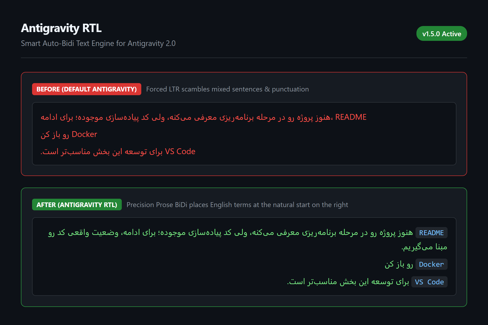

# Antigravity RTL (دعم الكتابة من اليمين إلى اليسار)

دعم ذكي وتلقائي للكتابة من اليمين إلى اليسار (العربية، الفارسية، الأردية، الكردية، البشتو) لتطبيق Google Antigravity 2.0.

[English](README.md) | [فارسی](README.fa.md) | [العربية](README.ar.md)

---



## لماذا Antigravity RTL؟

بشكل افتراضي، يعتمد تطبيق Antigravity 2.0 اتجاه الكتابة من اليسار إلى اليمين (`LTR`) لجميع نصوص المحادثة ولوحة المخرجات ومربعات الإدخال. بالنسبة للغات التي تُكتب من اليمين إلى اليسار مثل اللغة العربية، يتسبب هذا في عكس علامات الترقيم، وتشتت الكلمات الإنجليزية داخل الجمل، واختلال تدفق الفقرات.

يضيف هذا المشروع دعماً سلساً وذكياً لاتجاه الكتابة المزدوج (**Auto-Bidi**) دون تغيير خطوط التطبيق ودون التأثير على التحديثات التلقائية للبرنامج.

---

## الميزات الأساسية

| الميزة | السلوك مع الأداة |
| :--- | :--- |
| **تحديد تلقائي للاتجاه (Auto-Bidi)** | يحدد اتجاه كل فقرة وقائمة وعنوان تلقائياً (`RTL` أو `LTR`) بحسب المحتوى (كما في تيليجرام ونوشن). |
| **خوارزمية تركيب الجمل (Precision BiDi)** | يتعرف بدقة على الجمل العربية التي تبدأ بكلمات تقنية إنجليزية (مثل `Docker` أو `README`) ويضع الكلمة في بداية السطر على اليمين. |
| **الأكواد المضمنة الذكية (`code`)** | يحافظ على اتجاه اليمين لليسار للنصوص العربية الموضوعة داخل علامات التنصيص المائلة، مع إبقاء الأكواد البرمجية (`npm`, `git`, المسارات) بالاتجاه الطبيعي من اليسار إلى اليمين. |
| **عزل تام للأكواد البرمجية** | تظل قوالب الأكواد (`pre`)، والصيغ الرياضية (KaTeX)، ومخططات Mermaid دون أي تغيير من اليسار لليمين. |
| **تحديث الاتجاه أثناء الكتابة** | تبديل تلقائي ولحظي للاتجاه في مربع كتابة الرسائل (محرر Lexical) مع أول حرف يُكتب. |
| **حماية ضد التحديثات التلقائية** | حماية ثلاثية تضمن استمرار عمل الأداة حتى بعد تحديث التطبيق دون الحاجة لتدخل يدوي. |
| **استعادة آمنة بنقرة واحدة** | إنشاء نسخة احتياطية نظيفة (`app.asar.rtl-backup.bak`) تلقائياً وإمكانية العودة لضبط المصنع بنقرة زر. |

---

## التثبيت السريع

### المتطلبات
- نظام التشغيل ويندوز 10 أو 11 (64-بت)
- [Node.js](https://nodejs.org) (الإصدار 18 أو أحدث)
- تطبيق Google Antigravity 2.0

### خطوات التثبيت

استنسخ المستودع وشغّل ملف التثبيت:

```cmd
git clone https://github.com/YOUR_USERNAME/antigravity-rtl.git
cd antigravity-rtl
bin\install.cmd
```

*أو باستخدام npm:*

```bash
npm run apply
```

إذا كان تطبيق Antigravity مفتوحاً أثناء التثبيت، فسيتم تطبيق التعديل **مباشرةً وعلى الهواء** في النوافذ المفتوحة دون الحاجة لإعادة تشغيل البرنامج.

---

## إلغاء التثبيت / العودة للحالة الأصلية

لاستعادة الملف الأصلي للتطبيق وإلغاء كافة التعديلات:

```cmd
bin\uninstall.cmd
```

*أو عبر npm:*

```bash
npm run revert
```

---

## إخلاء المسؤولية (Disclaimer)

هذا المشروع هو أداة مفتوحة المصدر مستقلة طورها مجتمع المطورين، وليس له أي ارتباط رسمي أو رعاية أو اعتماد من قِبل شركة Google. يُعد اسم "Antigravity" علامة تجارية مسجلة لمالكها.

---

## الترخيص

مرخص تحت رخصة MIT مفتوحة المصدر. راجع ملف [LICENSE](LICENSE) للمزيد من التفاصيل.
